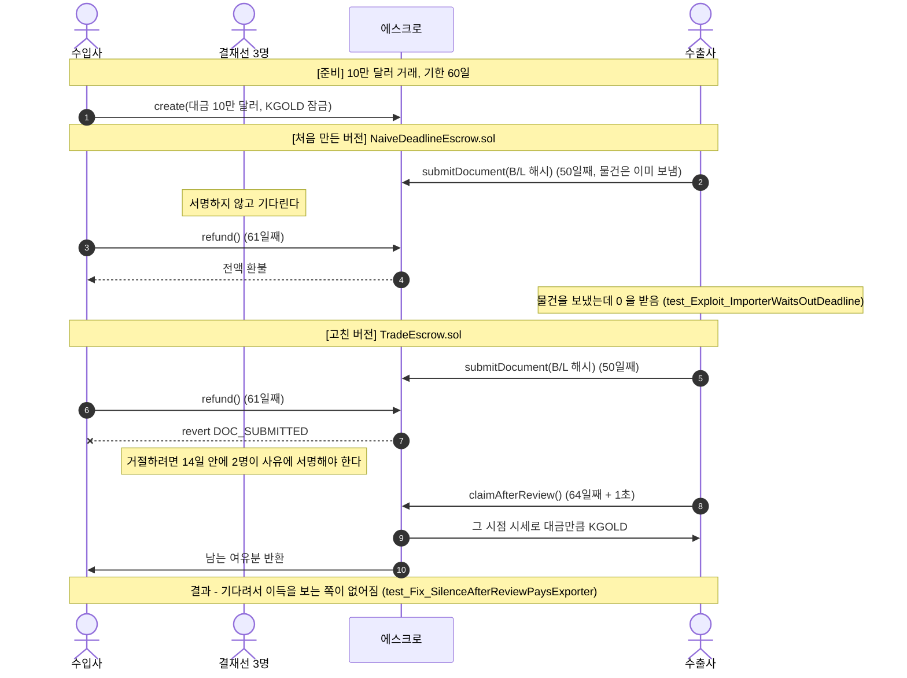
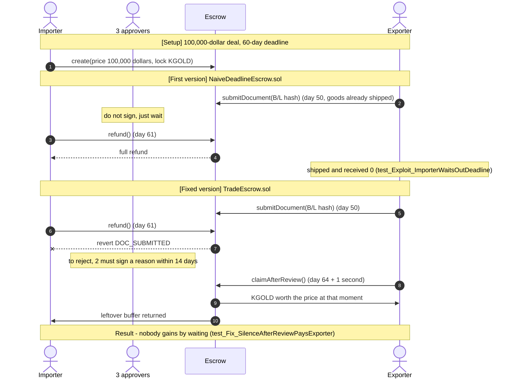

# K-Gold 무역 에스크로 구현: 결재선 2-of-3, 선적 서류, 기한, 담보 비율


지난 저장소 [kgold-reserve-breaker-lab](https://github.com/Andrewpark-hub/kgold-reserve-breaker-lab)에서 K-Gold 의 발행 한도, 보유고 증명, 회로차단기를 만들고 "다음은 무역 에스크로" 라고 적었습니다. 이 저장소는 그 에스크로를 **직접 구현해 본** 학습용 저장소입니다. 수입사가 KGOLD 를 잠그고, 수출사가 선적 서류를 올리고, 수입사 결재선 3명 중 2명이 서명하면 정산됩니다. 처음 만든 버전이 깨진 곳 세 군데를 **`처음 만든 버전(반례)` ↔ `고친 버전`** 쌍으로 남겨 Foundry 테스트 20개로 확인했습니다. 지난 저장소에서 "가격 위험은 에스크로로 옮겨갔다" 고 적어 둔 부분도 여기서 다뤘습니다.

> ⚠️ 이 저장소는 **K-Gold 설계를 코드로 옮겨 보며 어디서 깨지는지 확인하려는 학습용**입니다. 실제 은행, 무역보험, 선적 서류 시스템, 금 시세와 연동되지 않았고 금융·법률 검토를 거친 설계가 아닙니다. 어떤 코드도 프로덕션용이 아닙니다.

---

## 프로젝트 핵심 요소

1. **결재 서명이 무엇을 승인하는지 정하기 (01)**
   - 처음엔 결재선이 "거래 #id 를 정산해도 된다" 에 서명했다. 서명이 모인 뒤 수출사가 서류를 2,000개 선적에서 200개 선적으로 바꿔도 같은 서명으로 정산됐다(`test_Exploit_DocumentSwappedAfterApproval`)
   - 고친 버전은 EIP-712 서명 내용에 `dealId` 와 `docHash` 를 넣고, 서류는 한 번만 올릴 수 있게 했다
   - 지난 랩 오라클의 "서명자 주소 오름차순" 검사를 그대로 가져와서 한 명이 두 번 서명하는 것도 막았다

2. **기한과 환불을 누가 쥐고 있는지 바꾸기 (02)**
   - 설계 문서의 "기한 초과 시 환불" 을 그대로 옮기니, 결재선이 서명을 안 하고 기다리기만 하면 수출사가 물건을 보냈어도 수입사가 전액 환불받았다(`test_Exploit_ImporterWaitsOutDeadline`)
   - 고친 버전은 기한 안에 서류가 올라왔으면 **결재선 2명이 거절 사유에 서명해야만** 환불된다. 14일 동안 승인도 거절도 없으면 수출사가 정산을 요청할 수 있다
   - 서류가 끝까지 안 올라온 경우에만 원래 설계대로 기한 다음 날 환불된다

3. **지난 랩에서 미뤄 둔 가격 위험을 거래마다 계산하기 (03)**
   - 잠글 때 시세로 지급량을 정했더니, 금값이 15% 내리면 수출사가 10만 달러 대신 8만 5천 달러어치 금을 받았다(`test_Exploit_LockTimePriceUnderpaysExporter`)
   - 고친 버전은 대금의 110% 를 잠그고, **정산할 때 그 시점 시세로** 대금만큼만 주고 나머지는 돌려준다. 모자라면 정산을 보류하고 수입사가 더 넣어야 풀린다
   - 시세가 하루 넘게 안 바뀌었으면 정산하지 않는다. SEC 랩에서 본 "오라클이 멈춰 있을 때 거래를 허용하는" 문제를 피하려고 넣었다

---

## 시스템 아키텍처 & 라이프사이클 흐름

가장 배울 게 많았던 **02. 결재선이 기다리기만 할 때** 의 흐름입니다. 위는 처음 만든 버전, 아래는 고친 버전입니다. 처음 버전에서는 정산(결재선 서명)과 환불(기한)이 둘 다 수입사 쪽에 있어서, 수입사는 아무것도 안 하는 것만으로 이길 수 있었습니다.



정리하면, 처음 버전에서는 수입사가 "아무것도 안 하기" 를 고를 수 있었고 그 비용을 수출사가 냈다. 고친 버전에서는 서류가 올라온 뒤 침묵하면 수출사가 정산을 받는다. 수입사가 서류에 문제가 있다고 보면 2명이 서명한 거절로 그 판단을 체인에 남겨야 한다.

---

## 처음 만든 버전 3종 & 확인한 것

| # | 처음 만든 버전 | 반례 파일 | 깨지는 것을 보인 테스트 | 어긋난 지점 |
|---|---|---|---|---|
| 01 | 결재선이 `거래 #id` 에 서명, 서류 덮어쓰기 가능 | `naive/NaiveUnboundApprovalEscrow.sol` | `test_Exploit_DocumentSwappedAfterApproval` | 서명이 **어떤 서류**에 대한 건지 없음 |
| 02 | 기한이 지나면 수입사 환불 | `naive/NaiveDeadlineEscrow.sol` | `test_Exploit_ImporterWaitsOutDeadline` | 정산과 환불을 **같은 쪽**이 쥠 |
| 03 | 잠글 때 시세로 지급량 고정 | `naive/NaiveLockPriceEscrow.sol` | `test_Exploit_LockTimePriceUnderpaysExporter` | 가격 위험이 **수출사**에게 넘어감 |

### 01 서명이 서류에 묶여 있지 않았다
처음엔 다중 서명에서 막을 건 지난 랩 오라클에서 다 했다고 생각했다. 서명자 정렬, 중복 차단, 결재선인지 확인까지 그대로 넣었다. 그런데 서명 내용이 `거래 #id` 뿐이라서, 결재선이 서류 A 를 보고 서명한 뒤 수출사가 서류를 B 로 바꿔 올려도 서명은 그대로 유효했다. 정산은 됐고 체인에는 B 가 승인된 것으로 남았다.

동결 ZK 랩에서 증명에 동결 대상 주소가 안 들어가 있어서 생긴 문제와 같은 모양이었다. 그때도 검사 자체는 맞게 돌았는데, 검사하는 내용에 정작 중요한 값이 빠져 있었다. 그래서 이번엔 서명 내용(`Release(uint256 dealId, bytes32 docHash)`)에 서류 해시를 넣고, 서류는 한 번만 올릴 수 있게 했다. 결재선이 서류가 올라오기 전에 미리 서명해 둔 경우에도, 그 서명은 나중에 올라온 서류에는 쓸 수 없다(`test_Fix_PresignedApprovalDoesNotCoverLaterDocument`). EIP-712 도메인에는 처음부터 chainId 와 컨트랙트 주소를 넣었다. 동결 ZK 랩 README 한계에 "도메인 바인딩 미구현" 이라고 적었던 걸 이번엔 빼먹지 않으려고 했다.

### 02 기한을 정한 쪽이 기다리기만 하면 이겼다
K-Gold 설계 문서에는 "결재선 2-of-3 승인 시 정산, 기한 초과 시 환불" 이라고 적혀 있었다. 문장만 보면 공정해 보였는데 코드로 옮기니 승인하는 것도 수입사 결재선이고 환불받는 것도 수입사였다. 수출사가 50일째에 물건을 보내고 서류를 올려도, 결재선이 61일째까지 아무것도 안 하면 수입사가 전액 돌려받았다.

고친 버전은 "기한 안에 서류가 올라왔는가" 로 나눴다. 안 올라왔으면 원래대로 환불된다. 올라왔으면 환불은 결재선 2명이 거절 사유 해시에 서명해야만 되고, 그 사유 해시는 이벤트로 남는다. 14일 검토 기간 동안 승인도 거절도 없으면 수출사가 `claimAfterReview()` 로 정산을 요청한다. 검토 기간이 끝난 뒤에는 거절도 못 한다(`REVIEW_OVER`).

### 03 지난 랩에서 미뤄 둔 가격 위험이 여기로 왔다
지난 랩에서 토큰을 "1토큰 = 금 1그램" 으로 정의해서 금값을 발행 한도 계산에서 뺐다. 그때 README 에 "가격 위험이 사라진 게 아니라 에스크로로 옮겨갔다" 고 썼다. 무역 대금은 달러로 정해지니까 에스크로에서는 금값이 다시 필요했다. 처음엔 잠글 때 시세로 "10만 달러어치 = 781.25g" 을 계산해서 그대로 줬는데, 30일 뒤 금값이 15% 내리면 수출사가 받은 781.25g 은 8만 5천 달러어치였다.

고친 버전은 정산하는 순간의 시세로 다시 계산한다. 금값이 5% 내렸으면 822.369g 을 주고 남는 건 수입사에게 돌려준다. 잠글 때 110% 를 받아 두는 건 금값이 조금 움직일 때마다 보류되지 않게 하려는 여유분이다. 금값이 15% 내리면 919.118g 이 필요해서 잠근 860g 으로는 모자라고, 이때는 정산을 보류한다(`UNDERCOLLATERALIZED`). 수입사가 `topUp()` 으로 더 넣어야 풀린다. 시세 피드가 하루 넘게 안 바뀌었으면 시세를 모르는 상태라고 보고 역시 정산하지 않는다.

### 그리고 내 수정본도 완전하지 않다
- **금값이 내린 뒤 수입사가 추가로 안 넣으면 아무것도 안 된다.** 수출사는 정산을 못 받고, 수입사도 서류가 올라와 있어서 환불을 못 받는다. 금은 에스크로에 묶인 채로 있고, 그동안 손해를 보는 건 물건을 이미 보낸 수출사다(`test_Limit_ImporterCanStallByNotToppingUp`). 02 에서 막았던 "기다리기만 하면 되는" 문제가 담보 부족 상황에서 다시 생겼다.
- **지난 랩의 회로차단기가 걸리면 에스크로도 멈춘다.** 보유고 증명에 문제가 생겨 전송이 멈추면, 이미 에스크로에 들어가 있는 금도 정산, 거절, 환불이 전부 안 된다(`test_Limit_BreakerPauseFreezesEscrow`). 지난 랩에서는 "소각은 막지 않는다" 로 정했는데, 에스크로에서 돈이 나가는 건 소각이 아니라 전송이라서 그 예외가 적용되지 않았다. 두 모듈을 따로 만들 때는 안 보였던 부분이다.
- **거절은 여전히 수입사 쪽만 할 수 있다.** 진짜 물건을 받고도 결재선 2명이 거절하면 환불된다. 사유 해시가 남긴 하지만 그게 정당한 사유인지는 체인이 모른다. 분쟁은 결국 체인 밖으로 넘어간다.
- **서류가 진짜인지는 확인하지 않는다.** `docHash` 는 "이 파일" 을 가리킬 뿐이다. 결재선이 14일 동안 안 보면 가짜 서류로도 정산된다. 침묵해서 손해를 보는 쪽이 수출사에서 수입사로 바뀌었을 뿐이다.
- **시세는 관리자 한 명이 넣는다.** 지난 랩의 보유고 증명처럼 여러 노드 서명으로 바꿀 수 있지만 이번 범위에서는 하지 않았다.
- **비용.** 정산에 성공한 `release` 는 서명 2개 확인과 전송 2번을 포함해 약 12만 가스(121,804), 서명 확인이 없는 `claimAfterReview` 는 약 10만 가스(102,586)였다. 거래를 만드는 `create` 가 약 28만 가스(283,203)로 가장 비쌌다(`forge test -vvvv` 트레이스 기준).

---

## 기술 스택

| 구분 | 사용 기술 |
|---|---|
| **언어 / 컴파일러** | Solidity `0.8.25` (`foundry.toml` 에 고정) |
| **개발 · 테스트 프레임워크** | Foundry `1.8.1` (forge test, gas report, cheatcodes: `vm.sign`, `vm.prank`, `vm.warp`, `vm.expectRevert`, `vm.expectEmit`) |
| **테스트 라이브러리** | forge-std `v1.17.0` |
| **서명** | EIP-712 구조화 서명 + `ecrecover` (EIP-2 low-s 검사, 지난 랩 `ReserveOracle` 과 같은 방식) |
| **토큰** | 지난 저장소의 `KGold.sol` 을 그대로 가져옴 (1 KGOLD = 1g, decimals 3, 등록 기업 간 전송만) |
| **환경** | macOS (Apple Silicon) |
| **참고 자료** | K-Gold 설계(핀테크 아이디어 공모전), 지난 저장소의 `docs/kgold-design-mapping.md`, 블록체인 밋업데이 21회차(Wallet, EIP-712) 교재 |

---

## 트러블슈팅 및 환경 최적화

> **서명이 서류에 묶였는지 보는 테스트가, 그 검사를 지워도 통과했다**
> - **문제 상황:** 처음 쓴 `test_Fix_SignatureIsBoundToDocument` 는 결재선이 서류 A 에 서명하고 체인에는 B 가 올라온 경우 `NOT_APPROVER` 로 막히는지 봤다. 통과했다. 그런데 확인 삼아 `releaseDigest` 에서 `docHash` 를 **일부러 빼고** 다시 돌려도 여전히 통과했다.
> - **원인 분석:** 테스트 안에서 "A 에 대한 서명 내용" 을 `abi.encode(RELEASE_TYPEHASH, id, DOC_A)` 로 직접 만들고 있었다. 컨트랙트가 `docHash` 를 서명 내용에 넣든 안 넣든, 테스트가 만든 내용과 컨트랙트가 만든 내용은 처음부터 형식이 달라서 항상 `NOT_APPROVER` 가 났다. 테스트가 컨트랙트의 동작이 아니라 내가 만든 값을 검사하고 있었다.
> - **해결 방안:** 서명 내용을 테스트에서 만들지 않고 컨트랙트의 `releaseDigest(id)` 로만 받게 바꿨다. 결재선이 서류가 올라오기 전에 미리 서명해 둔 상황으로 바꾸니, `docHash` 를 빼면 서명 내용이 서류와 상관없어져서 정산이 그대로 통과하고 테스트가 실패한다(`next call did not revert as expected`). 지난 랩에서 퍼즈 테스트가 한도까지 못 가서 아무것도 안 보고 있던 것과 같은 일이 단위 테스트에서도 생겼다. 그래서 이번엔 핵심 검사 8개를 하나씩 지워 보고 매번 실패하는 테스트가 있는지 확인했다(`docs/escrow-design-mapping.md`).

> **에스크로가 KGOLD 를 받지 못했다 (`NOT_REGISTERED`)**
> - **문제 상황:** 거래를 만들 때 `create` 가 `NOT_REGISTERED` 로 되돌려졌다.
> - **원인 분석:** 지난 랩의 `KGold` 는 K-Gold 설계대로 **등록된 기업 사이에서만** 전송된다. 에스크로 컨트랙트도 받는 주소이자 보내는 주소라서, 기업이 아닌데도 등록이 필요했다.
> - **해결 방안:** 배포할 때 운영 관리자가 에스크로 주소를 `setRegistered` 로 등록하게 했다(`test/Base.t.sol`). 실제라면 "등록 기업 목록에 컨트랙트가 들어가도 되는가" 를 따로 정해야 할 것 같다.

> **그램 환산을 내림으로 하면 수출사가 몇 센트 덜 받는다**
> - **문제 상황:** 10만 달러를 금 1g 121.60달러로 나누면 822,368.42...mg 이 나온다. Solidity 나눗셈은 소수점을 버리니까 그냥 나누면 822,368mg 을 준다.
> - **원인 분석:** 822,368mg 은 121.60달러 기준으로 99,999.9488달러어치라 대금보다 5.12센트 적다. 금액은 작지만 "대금만큼 준다" 는 규칙이 깨진다.
> - **해결 방안:** `(priceCents * 1000 + cpg - 1) / cpg` 로 올림을 해서 822,369mg 을 준다. 내림으로 바꿔 보면 `test_Fix_PaysByPriceAtSettlementAndReturnsRest` 를 포함해 테스트 3개가 실패한다. 올림으로 생기는 1mg 미만의 차이는 수입사가 낸다.

---

## 실행 가이드 (Quick Start)

### 사전 조건 (Prerequisites)
- [Foundry](https://book.getfoundry.sh/) (`forge` 1.8.x)

### 1) 저장소 받기 & 빌드
```bash
git clone --recursive https://github.com/Andrewpark-hub/kgold-trade-escrow-lab.git
cd kgold-trade-escrow-lab
forge build            # solc 0.8.25 자동 사용
```

### 2) 테스트 (20개 전부 통과)
```bash
forge test -vv
```

### 3) 하나씩 따라가며 보기
```bash
forge test --match-path test/01_Approval.t.sol -vvv         # 결재 서명과 서류 (바꿔치기 반례)
forge test --match-path test/02_Deadline.t.sol -vvv         # 기한, 환불, 검토 기간 (기다리기 반례)
forge test --match-path test/03_CollateralRatio.t.sol -vvv  # 담보 비율, 시세 만료, 한계 2개
forge test --gas-report                                     # 함수별 가스
```

---

## 저장소 구조

```
src/
  KGold.sol            금 담보 토큰 (지난 저장소에서 그대로 가져옴)
  GoldPriceFeed.sol    금 1g 달러 시세 (센트) + 갱신 시각
  TradeEscrow.sol      무역 에스크로 (결재선 2-of-3 EIP-712, 선적 서류, 기한, 담보 비율)
test/
  Base.t.sol           배포 + 결재선 서명 헬퍼 + 회로차단기 대신 쓰는 MockGate
  01_Approval.t.sol   02_Deadline.t.sol   03_CollateralRatio.t.sol
  naive/               처음 만든 버전 (반례 3종)
docs/
  escrow-design-mapping.md   지난 저장소에서 넘어온 항목 → 구현/미구현, 검사 지워 보기 결과, 남은 질문
```

---

## 배운 것 & 다음

- 지난 랩에서 "가격 위험은 에스크로로 옮겨갔다" 고 쓸 때는 거기서 끝날 줄 알았다. 실제로 옮겨 오니 가격 위험은 담보 부족이 되고, 담보 부족은 "수입사가 안 넣으면 멈춘다" 가 되고, 결국 02 에서 막은 기다리기 문제로 다시 이어졌다. 위험이 어디로 가는지 한 번 더 따라가 봐야 했다.
- 설계 문서의 한 문장("승인 시 정산, 기한 초과 시 환불")이 두 사람 사이에서 누가 무엇을 쥐는지를 정하고 있었다. 문장으로 읽을 때는 몰랐고, 수입사 쪽 함수와 수출사 쪽 함수를 나눠서 적어 보니 보였다.
- 두 모듈을 따로 만들면 각자 맞아도 같이 붙였을 때 새로운 문제가 생긴다는 걸 회로차단기와 에스크로에서 봤다.
- 테스트가 통과해도 그 테스트가 무엇을 검사하는지는 따로 확인해야 했다. 이번엔 테스트를 다 쓰자마자 검사를 지워 보는 것부터 했다.
- 다음에는 담보가 모자랄 때 기한을 두고 잠긴 만큼이라도 정산하는 방식을 시험해 보고, 회로차단기가 걸렸을 때 에스크로 환불을 허용할지 정해 보려 한다. 남은 질문은 `docs/` 에 적어 두었다.

---

*이 저장소의 반례 코드(`test/naive/`)는 학습 목적의 의도된 결함을 포함합니다. 어떤 코드도 프로덕션에 사용하지 마세요. 또한 이 저장소는 금융·법률 자문이 아닙니다.*

---
---

# Building K-Gold's Trade Escrow: 2-of-3 Approval, Shipping Documents, Deadlines, Collateral Ratio

*English version. The Korean original is above.*


In my previous repository, [kgold-reserve-breaker-lab](https://github.com/Andrewpark-hub/kgold-reserve-breaker-lab), I built K-Gold's mint cap, proof of reserve and circuit breaker, and wrote that the trade escrow would come next. This learning repository is my attempt at **actually building** that escrow. The importer locks KGOLD, the exporter uploads a shipping document, and two of the importer's three approvers sign to settle. The three places where my first version broke are kept as **`first version (counterexample)` ↔ `fixed version`** pairs, checked with 20 Foundry tests. It also picks up the part I left in the previous README: "the price risk moved to the escrow."

> ⚠️ This repository is **a learning exercise in turning the K-Gold design into code and seeing where it breaks**. It is not connected to a real bank, trade insurer, shipping-document system or gold price, and the design has not been reviewed financially or legally. None of this code is meant for production.

---

## Key Components

1. **Deciding what an approval signature actually approves (01)**
   - At first the approvers signed "deal #id may be settled." After the signatures were collected, the exporter changed the document from a 2,000-unit shipment to a 200-unit one, and the same signatures still settled it (`test_Exploit_DocumentSwappedAfterApproval`)
   - The fixed version puts `dealId` and `docHash` into the EIP-712 message, and a document can be uploaded only once
   - The "signer addresses in ascending order" check from the previous oracle is reused, so one approver cannot sign twice

2. **Changing who holds the deadline and the refund (02)**
   - Translating "refund after the deadline" from the design document literally meant the approvers could just wait. Even if the exporter had shipped, the importer got a full refund (`test_Exploit_ImporterWaitsOutDeadline`)
   - In the fixed version, once a document arrives before the deadline, a refund needs **two approvers to sign a rejection reason**. If there is neither approval nor rejection for 14 days, the exporter can claim settlement
   - Only when no document ever arrives is the importer refunded the day after the deadline, as originally designed

3. **Computing, per deal, the price risk I deferred last time (03)**
   - Fixing the payout at the lock-time price meant that a 15% drop in gold paid the exporter 85,000 dollars worth of gold instead of 100,000 (`test_Exploit_LockTimePriceUnderpaysExporter`)
   - The fixed version locks 110% of the price and, **at the gold price at settlement time**, pays exactly the price and returns the rest. If the lock is not enough, settlement is held until the importer tops up
   - If the price feed has not updated for more than a day, settlement is also held. I added this to avoid the "trade allowed while the oracle is silent" problem from my SEC lab

---

## System Architecture & Lifecycle Flow

The flow I learned the most from is **02. when the approvers just wait**. The top half is the first version, the bottom half is the fixed one. In the first version both settlement (approver signatures) and refund (the deadline) sat on the importer's side, so the importer could win by doing nothing.



In short, in the first version the importer could choose to do nothing, and the exporter paid for it. In the fixed version, staying silent after a document arrives means the exporter gets paid. If the importer thinks something is wrong with the document, two approvers have to put that judgment on chain as a signed rejection.

---

## The 3 First Versions & What I Found

| # | First version | Counterexample file | Test showing the break | What was off |
|---|---|---|---|---|
| 01 | Approvers sign `deal #id`, document can be overwritten | `naive/NaiveUnboundApprovalEscrow.sol` | `test_Exploit_DocumentSwappedAfterApproval` | No record of **which document** was approved |
| 02 | Importer refunded after the deadline | `naive/NaiveDeadlineEscrow.sol` | `test_Exploit_ImporterWaitsOutDeadline` | Settlement and refund held by **the same side** |
| 03 | Payout fixed at the lock-time price | `naive/NaiveLockPriceEscrow.sol` | `test_Exploit_LockTimePriceUnderpaysExporter` | Price risk handed to **the exporter** |

### 01 The signature was not tied to the document
I first thought the multisig part was already solved by the previous oracle. I reused signer sorting, duplicate blocking and the approver check as they were. But the signed message was only `deal #id`, so after the approvers signed while looking at document A, the exporter could upload document B instead and the signatures stayed valid. Settlement went through, and the chain recorded B as approved.

It had the same shape as the problem in my freeze ZK lab, where the proof did not include the address being frozen. There too the check ran correctly, but the thing it checked was missing the value that mattered. So this time the message (`Release(uint256 dealId, bytes32 docHash)`) includes the document hash, and the document can be uploaded only once. Even if the approvers sign early, before any document is uploaded, that signature cannot be used for a document that arrives later (`test_Fix_PresignedApprovalDoesNotCoverLaterDocument`). The EIP-712 domain includes chainId and the contract address from the start. I had listed "no domain binding" as a limit in the freeze ZK lab README and tried not to miss it this time.

### 02 Whoever set the deadline could win by waiting
The K-Gold design document said "settle on 2-of-3 approval, refund after the deadline." As a sentence it looked fair, but in code both the approving and the refund belonged to the importer. Even if the exporter shipped on day 50 and uploaded the document, the importer got everything back if the approvers did nothing until day 61.

The fixed version splits on "did a document arrive before the deadline?" If not, the refund works as before. If it did, a refund needs two approvers to sign a rejection reason hash, and that hash is emitted as an event. If there is neither approval nor rejection during the 14-day review period, the exporter calls `claimAfterReview()`. After the review period, rejection is no longer possible (`REVIEW_OVER`).

### 03 The price risk I deferred last time ended up here
In the previous lab I defined the token as "1 token = 1 gram of gold" to keep the gold price out of the mint cap. I wrote in that README that "the price risk did not disappear, it moved to the escrow." Trade prices are set in dollars, so the escrow needed the gold price again. At first I computed "100,000 dollars = 781.25 g" at lock time and paid that out, but if gold fell 15% over 30 days, those 781.25 g were worth 85,000 dollars.

The fixed version recomputes at the moment of settlement. If gold is down 5%, it pays 822.369 g and returns the rest to the importer. Locking 110% up front is a buffer so that small price moves do not hold every deal. If gold is down 15%, 919.118 g is needed and the 860 g locked is not enough, so settlement is held (`UNDERCOLLATERALIZED`) until the importer adds more with `topUp()`. If the price feed has not changed for over a day, the contract treats the price as unknown and does not settle either.

### And my fix is not complete either
- **If gold falls and the importer never tops up, nothing can happen.** The exporter cannot be paid, and the importer cannot be refunded because a document is on file. The gold stays locked, and the one losing out is the exporter who already shipped (`test_Limit_ImporterCanStallByNotToppingUp`). The "just wait" problem I closed in 02 shows up again when collateral is short.
- **When the previous lab's circuit breaker trips, the escrow freezes too.** If transfers stop because of a reserve problem, gold already in the escrow cannot be settled, rejected or refunded (`test_Limit_BreakerPauseFreezesEscrow`). Last time I decided "burns are never blocked," but money leaving the escrow is a transfer, not a burn, so that exception does not apply. I did not see this while building the two modules separately.
- **Only the importer's side can reject.** If two approvers reject after receiving real goods, the importer is refunded. The reason hash is recorded, but the chain cannot tell whether it is a legitimate reason. Disputes still end up off chain.
- **The contract does not check whether a document is real.** `docHash` only points at "this file." If the approvers do not look for 14 days, a fake document also gets paid. The side that loses by staying silent just changed from the exporter to the importer.
- **One admin sets the price.** It could be changed to multiple node signatures like the previous proof of reserve, but I did not do that here.
- **Cost.** A successful `release`, including two signature checks and two transfers, took about 120,000 gas (121,804), and `claimAfterReview`, which has no signature check, about 100,000 (102,586). `create` was the most expensive at about 280,000 gas (283,203) (from `forge test -vvvv` traces).

---

## Tech Stack

| Category | Technology |
|---|---|
| **Language / Compiler** | Solidity `0.8.25` (pinned in `foundry.toml`) |
| **Dev & Test Framework** | Foundry `1.8.1` (forge test, gas report, cheatcodes: `vm.sign`, `vm.prank`, `vm.warp`, `vm.expectRevert`, `vm.expectEmit`) |
| **Test Library** | forge-std `v1.17.0` |
| **Signatures** | EIP-712 typed signatures + `ecrecover` (EIP-2 low-s check, same as the previous `ReserveOracle`) |
| **Token** | `KGold.sol` copied unchanged from the previous repository (1 KGOLD = 1 g, decimals 3, transfers only between registered companies) |
| **Environment** | macOS (Apple Silicon) |
| **References** | K-Gold design (fintech idea competition), the previous repository's `docs/kgold-design-mapping.md`, Blockchain Meetup Day #21 (Wallet, EIP-712) materials |

---

## Troubleshooting & Environment Notes

> **The test for "signature tied to the document" still passed after I removed that check**
> - **Problem:** My first `test_Fix_SignatureIsBoundToDocument` checked that approvers signing document A, while B was on chain, was blocked with `NOT_APPROVER`. It passed. But when I **deliberately removed** `docHash` from `releaseDigest` and ran it again, it still passed.
> - **Cause:** The test built "the message for A" itself with `abi.encode(RELEASE_TYPEHASH, id, DOC_A)`. Whether or not the contract included `docHash`, the message the test built and the one the contract built had different formats from the start, so it always reverted with `NOT_APPROVER`. The test was checking a value I made, not the contract's behavior.
> - **Fix:** The test no longer builds the message; it only takes it from the contract's `releaseDigest(id)`. I changed the scenario to approvers signing early, before any document is uploaded. Now if `docHash` is removed, the message no longer depends on the document, settlement goes through, and the test fails (`next call did not revert as expected`). In the previous lab a fuzz test never reached the cap and checked nothing; the same thing happened here in a unit test. So this time I removed each of the 8 key checks one by one and confirmed that some test fails every time (`docs/escrow-design-mapping.md`).

> **The escrow could not receive KGOLD (`NOT_REGISTERED`)**
> - **Problem:** `create` reverted with `NOT_REGISTERED`.
> - **Cause:** Following the K-Gold design, the previous lab's `KGold` only transfers **between registered companies**. The escrow contract both receives and sends, so it needed registering even though it is not a company.
> - **Fix:** The operating admin registers the escrow address with `setRegistered` at deployment (`test/Base.t.sol`). In practice, whether a contract may be on the registered-company list would need its own decision.

> **Rounding grams down underpays the exporter by a few cents**
> - **Problem:** 100,000 dollars divided by 121.60 dollars per gram is 822,368.42... mg. Solidity division drops the fraction, so a plain division pays 822,368 mg.
> - **Cause:** At 121.60 dollars per gram, 822,368 mg is worth 99,999.9488 dollars, 5.12 cents short. The amount is small, but the rule "pay exactly the price" breaks.
> - **Fix:** Rounding up with `(priceCents * 1000 + cpg - 1) / cpg` pays 822,369 mg. Switching back to rounding down makes 3 tests fail, including `test_Fix_PaysByPriceAtSettlementAndReturnsRest`. The sub-milligram difference from rounding up is paid by the importer.

---

## Quick Start

### Prerequisites
- [Foundry](https://book.getfoundry.sh/) (`forge` 1.8.x)

### 1) Clone & build
```bash
git clone --recursive https://github.com/Andrewpark-hub/kgold-trade-escrow-lab.git
cd kgold-trade-escrow-lab
forge build            # uses solc 0.8.25 automatically
```

### 2) Test (all 20 pass)
```bash
forge test -vv
```

### 3) Step through one at a time
```bash
forge test --match-path test/01_Approval.t.sol -vvv         # approval signatures and documents (swap counterexample)
forge test --match-path test/02_Deadline.t.sol -vvv         # deadline, refund, review period (waiting counterexample)
forge test --match-path test/03_CollateralRatio.t.sol -vvv  # collateral ratio, stale price, 2 limits
forge test --gas-report                                     # gas per function
```

---

## Repository Layout

```
src/
  KGold.sol            gold-backed token (copied unchanged from the previous repository)
  GoldPriceFeed.sol    gold price per gram in cents + update time
  TradeEscrow.sol      trade escrow (2-of-3 EIP-712 approvers, shipping document, deadline, collateral ratio)
test/
  Base.t.sol           deployment + approver signing helpers + MockGate standing in for the circuit breaker
  01_Approval.t.sol   02_Deadline.t.sol   03_CollateralRatio.t.sol
  naive/               first versions (3 counterexamples)
docs/
  escrow-design-mapping.md   items carried over from the previous repository → built/not built, check-removal results, open questions
```

---

## What I Learned & Next

- When I wrote "the price risk moved to the escrow" last time, I thought that was where it ended. Once I actually moved it here, price risk became undercollateralization, undercollateralization became "it stops if the importer does not add more," and that led back to the waiting problem I closed in 02. I had to follow where the risk went one more step.
- One sentence in the design document ("settle on approval, refund after the deadline") was deciding who holds what between two parties. I did not notice while reading it as a sentence; it showed up when I wrote out the importer's functions and the exporter's functions separately.
- With the circuit breaker and the escrow I saw that two modules can each be correct on their own and still create a new problem when connected.
- Even when a test passes, I had to check separately what it is actually checking. This time I did the check-removal pass as soon as the tests were written.
- Next I want to try settling at least what is locked after a top-up deadline when collateral is short, and decide whether escrow refunds should be allowed while the circuit breaker is tripped. Open questions are in `docs/`.

---

*The counterexample code in this repository (`test/naive/`) contains intentional flaws for learning. Do not use any of this code in production. This repository is not financial or legal advice.*
